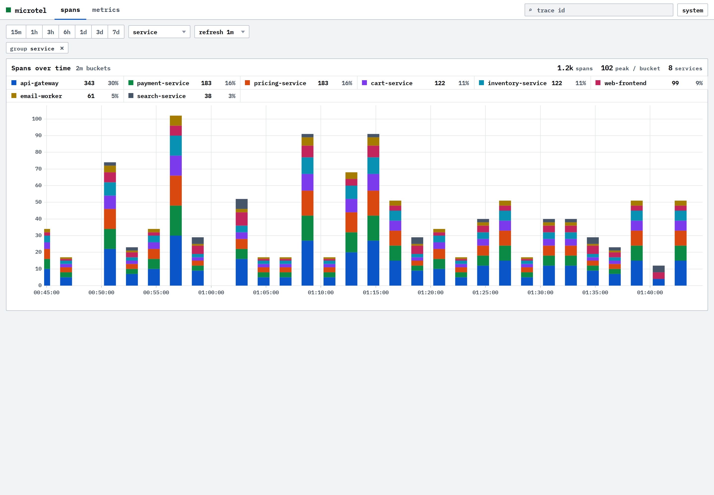
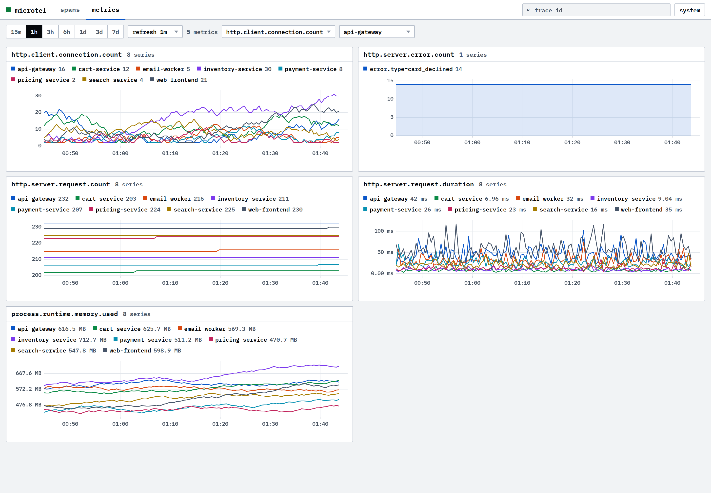

# microtel

There are many opentelemetry tools, but this one is mine. I just want something simple
for my VPS, that will consume very little resources, so here we are:
- single rust binary
- rocksdb for storage, no separate DB
- listens for HTTP + protobuf spans and metrics (logs are not supported for now)
- serves a basic API + solidjs UI (pure vibes ✨)

That's it. It seems to be fine for me and runs in a few dozen MBs of memory.

## web UI

